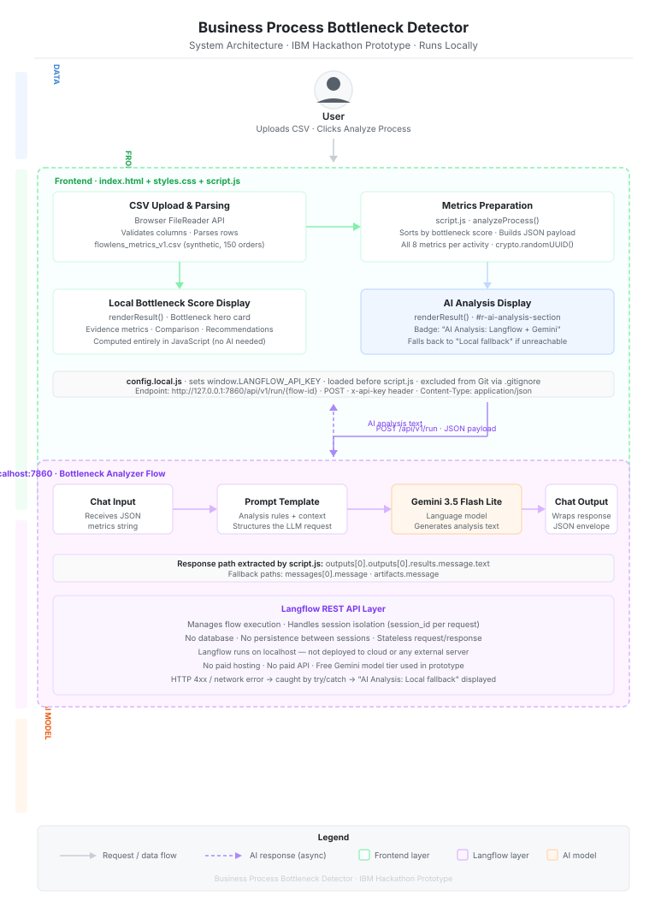

# System Architecture

**Business Process Bottleneck Detector** — IBM Hackathon Prototype

---



---

## Overview

The prototype is a fully client-side web application that runs locally in a browser. There is no deployed backend, no database, and no paid hosting. The only external dependency at runtime is a locally running [Langflow](https://github.com/langflow-ai/langflow) instance, which acts as the AI orchestration layer.

```
User
  ↓  uploads CSV / clicks Analyze
Frontend (index.html + script.js)
  ↓  parses CSV · computes bottleneck scores · builds JSON payload
Langflow REST API  ← POST http://127.0.0.1:7860/api/v1/run/{flow-id}
  ↓
Bottleneck Analyzer Flow
  ├── Chat Input  →  Prompt Template  →  Gemini 3.5 Flash Lite  →  Chat Output
  ↓
JSON response  →  script.js extracts analysis text
  ↓
Frontend AI Analysis Display
```

---

## Components

### User

The user opens `index.html` directly in a browser. They upload a CSV file containing process metrics (or use the built-in sample) and click **Analyze Process**.

---

### Frontend

Three files collaborate to form the frontend:

| File | Role |
|---|---|
| `index.html` | Application shell, UI markup, section structure |
| `styles.css` | All styling — no frameworks, no external dependencies |
| `script.js` | CSV parsing, bottleneck scoring, Langflow API call, result rendering |

The frontend has four internal responsibilities:

#### 1. CSV Upload & Parsing
`parseCSV()` in `script.js` reads the uploaded file via the browser `FileReader` API, validates required columns, and converts each row into a typed process object with camelCase properties. The sample dataset `flowlens_metrics_v1.csv` (synthetic, 150 orders, 6 activities, ~900 events over 30 days) is used for the prototype MVP.

#### 2. Metrics Preparation
`analyzeProcess()` sorts all parsed processes by bottleneck score descending, then serializes the full metrics for every process into a JSON payload:

```json
{
  "processes": [
    {
      "activity": "Packing",
      "avg_processing_min": 29.07,
      "avg_waiting_min": 4.12,
      "delay_rework_rate": 0.28,
      "rework_rate": 0.19,
      "volume_time_correlation": 0.87,
      "controllability": 1.0,
      "bottleneck_score": 75.04
    },
    ...
  ]
}
```

This payload is sent to Langflow as the `input_value` of a chat-type request.

#### 3. Local Bottleneck Score Display
`renderResult()` populates the bottleneck hero card, evidence metric cards, process comparison, possible causes, and metric-driven recommendations using only JavaScript — no AI call is required for this section. It reflects the sorted, scored output from step 2.

#### 4. AI Analysis Display
After the Langflow response is received, `renderResult()` populates the **AI Analysis** section:
- **Success:** badge reads `AI Analysis: Langflow + Gemini`; card renders the full Gemini-generated analysis text on a blue-tinted background.
- **Failure:** badge reads `AI Analysis: Local fallback`; card shows the specific error reason. All local metric results remain visible.

---

### API Key Configuration

`config.local.js` sets `window.LANGFLOW_API_KEY` before `script.js` is loaded. It is listed in `.gitignore` and must never be committed. `config.example.js` provides the safe placeholder template for new contributors.

```
<!-- index.html load order -->
<script src="config.local.js"></script>   ← sets window.LANGFLOW_API_KEY
<script src="script.js"></script>          ← reads window.LANGFLOW_API_KEY || ""
```

---

### Langflow REST API

The frontend calls Langflow via a single `fetch()` call:

```
Method:   POST
Endpoint: http://127.0.0.1:7860/api/v1/run/937171c0-42ed-4bf0-9e93-32746afd2dc8
Headers:  Content-Type: application/json
          x-api-key: <from config.local.js>
Body:
  {
    "output_type": "chat",
    "input_type":  "chat",
    "input_value": "<JSON string of all process metrics>",
    "session_id":  "<crypto.randomUUID()>"
  }
```

Each request uses a fresh `session_id` so sessions are fully isolated. Langflow is stateless from the frontend's perspective.

---

### Bottleneck Analyzer Flow (inside Langflow)

The Langflow flow contains four nodes in a linear chain:

```
Chat Input → Prompt Template → Gemini 3.5 Flash Lite → Chat Output
```

| Node | Role |
|---|---|
| **Chat Input** | Receives the serialized JSON metrics string from the frontend |
| **Prompt Template** | Injects the metrics into a structured prompt with analysis rules, metric definitions, and expected reasoning format |
| **Gemini 3.5 Flash Lite** | Language model — generates a natural-language bottleneck analysis based on the prompt |
| **Chat Output** | Packages the model response into Langflow's standard JSON envelope |

**The Prompt Template is where the analytical intelligence lives.** JavaScript computes the bottleneck scores, but the contextual reasoning — why a metric matters, how to interpret combinations of signals, what to recommend — is defined in the Prompt Template and executed by Gemini.

---

### Gemini 3.5 Flash Lite

Google's Gemini 3.5 Flash Lite is used as the language model. It is accessed through Langflow's built-in Google Generative AI component. No separate Google API key management is required in the frontend — the model is configured inside the Langflow flow.

Gemini receives the structured prompt (metrics + analysis rules from the Prompt Template) and returns a natural-language analysis covering:
- Which process is the priority bottleneck and why
- How the metrics combine to indicate operational friction
- What the volume–time correlation pattern suggests
- Contextual recommendations

---

### Response Extraction

`script.js` extracts the text from the Langflow response using three fallback paths in priority order:

```js
langflowText =
  json?.outputs?.[0]?.outputs?.[0]?.results?.message?.text ||
  json?.outputs?.[0]?.outputs?.[0]?.messages?.[0]?.message  ||
  json?.outputs?.[0]?.outputs?.[0]?.artifacts?.message      ||
  null;
```

If none of these paths yield a string, `langflowError` is set and the local fallback display is shown.

---

## Data Flow Summary

```
flowlens_metrics_v1.csv (synthetic)
  │
  ▼
parseCSV()              — browser FileReader, column validation, typed row objects
  │
  ▼
analyzeProcess()        — sort by bottleneck_score, build metricsPayload JSON
  │
  ├──▶  renderResult() (local)   — score cards, comparison, recommendations (JS only)
  │
  └──▶  fetch() → Langflow POST  — full metrics JSON, session_id, x-api-key
                │
                ▼
          Chat Input
                │
                ▼
          Prompt Template  — analysis rules + metrics injected
                │
                ▼
          Gemini 3.5 Flash Lite  — LLM inference
                │
                ▼
          Chat Output  — JSON envelope
                │
                ▼
        response.json()
                │
                ▼
        extract outputs[0].outputs[0].results.message.text
                │
                ▼
        renderResult() (AI section)  — badge + analysis text displayed
```

---

## Infrastructure Notes

| Property | Value |
|---|---|
| Hosting | None — static files opened directly in browser |
| Backend server | None |
| Database | None |
| Deployment | None |
| Paid APIs | None |
| Langflow | Local — `http://127.0.0.1:7860` |
| AI model | Gemini 3.5 Flash Lite (configured inside Langflow flow) |
| Error handling | `try/catch` around `fetch()` — any failure shows local fallback |
| API key storage | `config.local.js` (gitignored) — never committed |

---

*IBM Hackathon — Business Process Bottleneck Detector*
